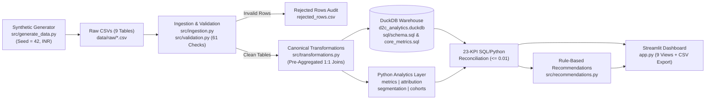
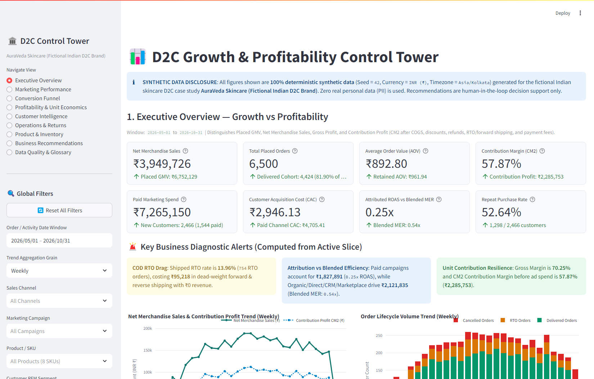
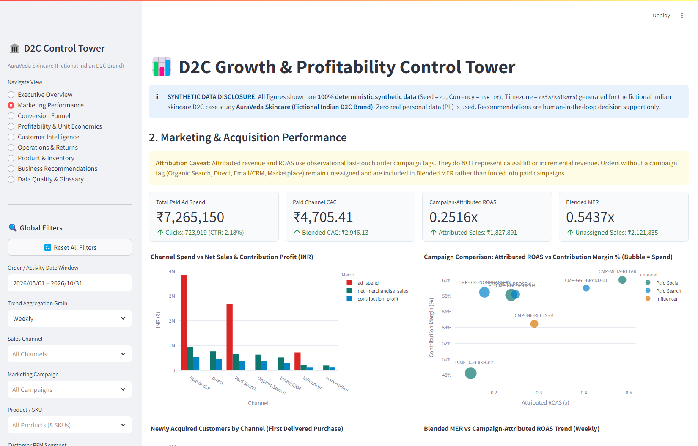
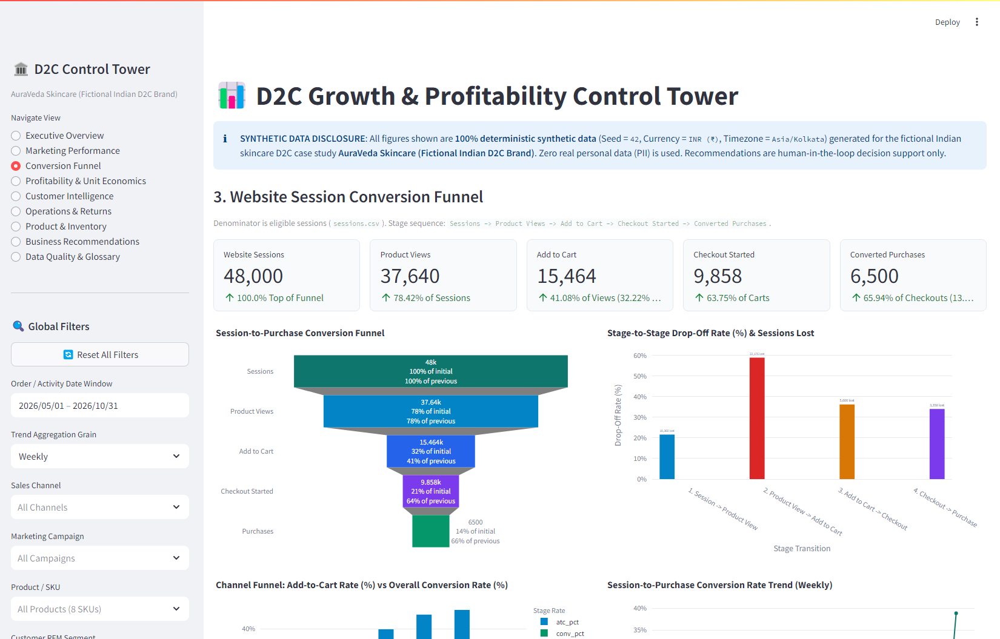
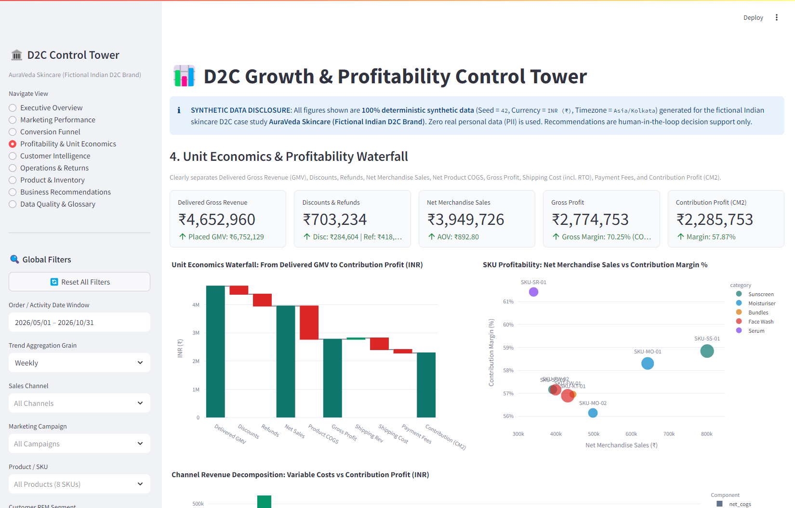
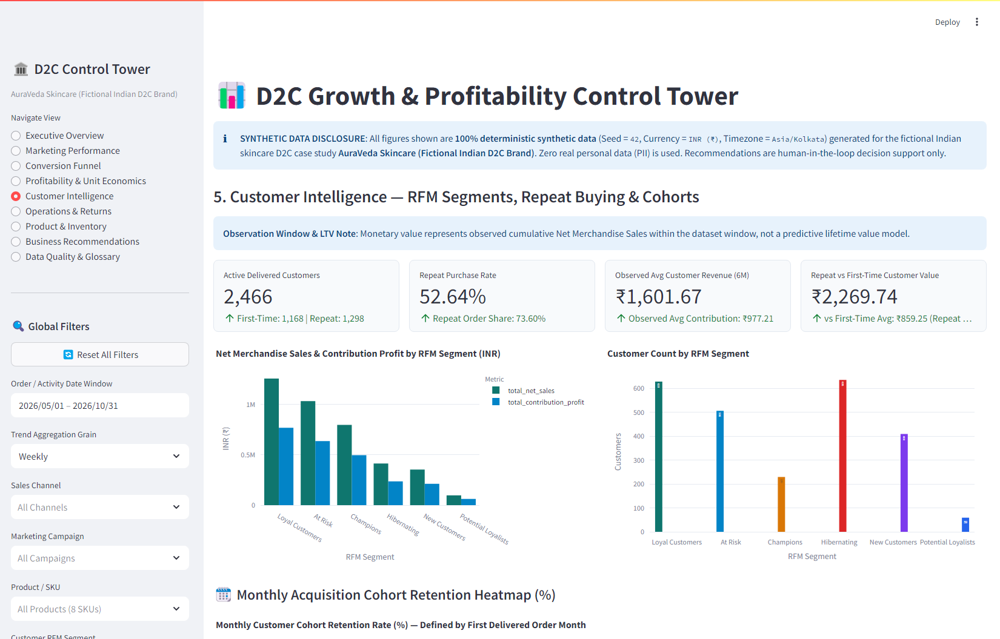
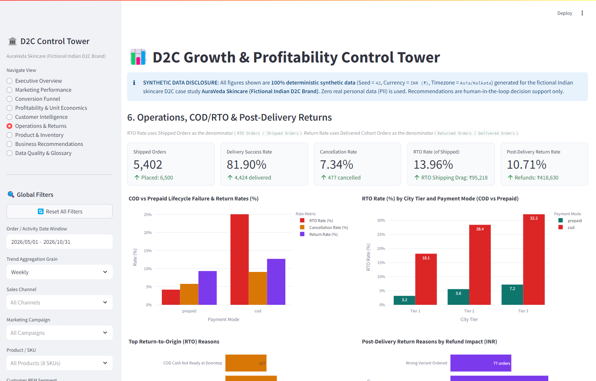
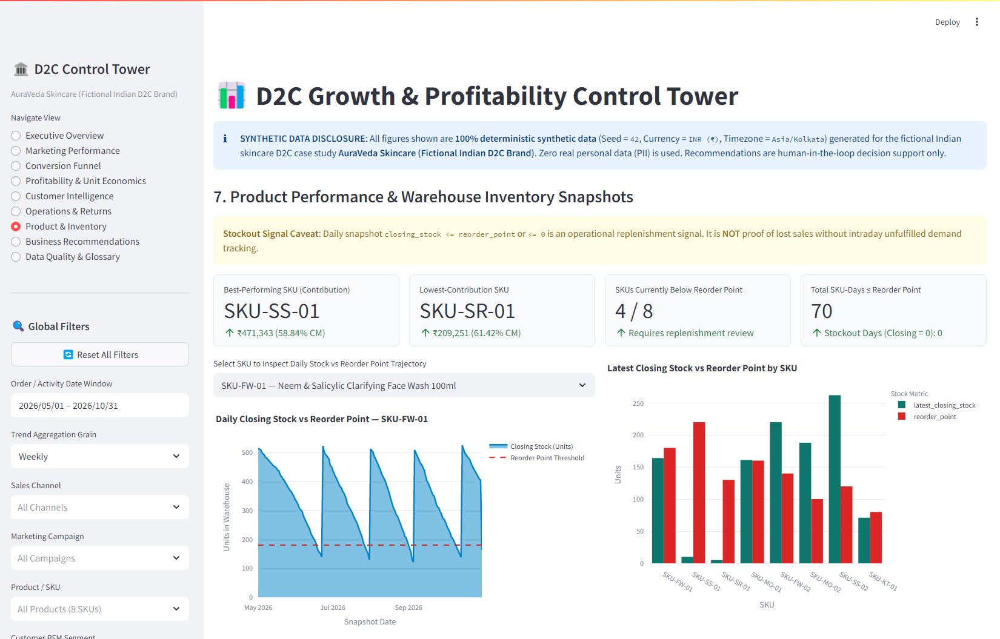
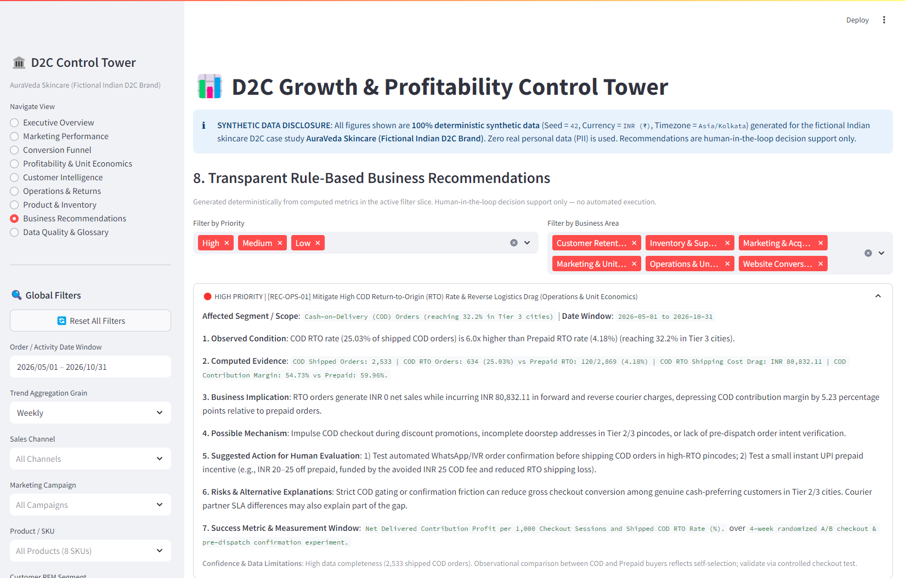
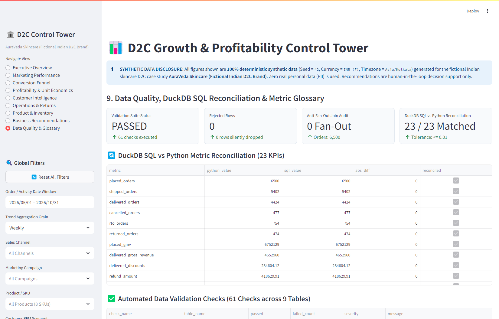

# D2C Growth & Profitability Control Tower

## Introduction

I built this project to explore a problem that comes up constantly in direct-to-consumer (D2C) e-commerce: a brand can grow its monthly order volume and still lose money on the bottom line.

When I looked at typical e-commerce portfolio projects, most of them stopped at plotting gross revenue by month or product category. In practice, particularly for Indian D2C brands, top-line Gross Merchandise Value (GMV) is a poor proxy for profitability. Between the moment a customer clicks an ad and the moment cash actually settles in the bank, margins get chipped away by promotional discounts, pre-shipment cancellations, Cash-on-Delivery (COD) doorstep refusals (Return-to-Origin, or RTO), post-delivery refunds, payment gateway fees, and forward/reverse courier charges.

To model and analyze these mechanics end to end, I created a fictional Indian skincare brand (**AuraVeda Skincare**) with a deterministic synthetic dataset (`seed = 42`, `INR`, `Asia/Kolkata`) covering six months of operations (`2026-05-01` to `2026-10-31`), built a validation and canonical transformation pipeline into **DuckDB**, reconciled **23 metrics between SQL and Python**, and built a 9-page **Streamlit** dashboard on top of the tested metric layer.

> **Synthetic Data Disclosure**: All datasets in this repository are 100% synthetic and generated deterministically with a fixed random seed (`42`). No real customer data or PII is used, and the numbers represent a simulated case study rather than actual company performance.

---

## The Business Problem

In a typical small D2C setup, teams look at disconnected numbers:
- The **marketing team** tracks ad spend and platform-attributed ROAS on placed orders.
- The **operations team** tracks courier dispatches, COD refusals (RTO), and warehouse stock levels.
- The **finance team** looks at net realized revenue after discounts, refunds, product COGS, and logistics invoices.

Because these tables live at different grains—daily campaign spend, session-level funnel events, order headers, SKU line items, shipments, returns, and daily stock snapshots—joining them carelessly in SQL or Pandas often causes row multiplication (join fan-out) that inflates revenue. Even without join bugs, optimizing for gross ROAS alone can push the team to scale discount-heavy campaigns that attract high-RTO COD orders and lose money after variable costs.

---

## What the Application Does

The project is organized as a modular analytics pipeline and decision-support app:

1. **Generates a reproducible 9-table e-commerce dataset** (`src/generate_data.py`) modeling 8 skincare SKUs, 3,200 customers, 48,000 sessions, 6,500 orders, 9,722 order line items, 1,288 campaign-day spend rows, 5,402 shipments, 643 return cases, and 1,472 daily inventory snapshots.
2. **Validates data quality before analytics run** (`src/validation.py`) using 61 checks across schemas, primary keys, foreign keys, negative values, date chronology, header-vs-line discount totals, and warehouse stock arithmetic (`opening + received - sold == closing`). Bad rows are never silently dropped; they are written to a rejected-rows audit file with specific failure reasons.
3. **Builds a fan-out-free canonical model** (`src/transformations.py`) by pre-aggregating `order_items`, `shipments`, and `returns` to `order_id` grain before joining to `orders`, then loads both raw and canonical tables into **DuckDB**.
4. **Computes and reconciles metrics in SQL and Python** (`src/metrics.py`, `src/attribution.py`, `src/segmentation.py`, `src/cohorts.py`, `sql/core_metrics.sql`), ensuring all 23 core metrics match within `0.01` and returning `NA` (`None`) whenever a denominator is zero.
5. **Evaluates rule-based recommendations** (`src/recommendations.py`) that flag specific operational or marketing issues from the active data slice—along with caveats and proposed experiments for human review.
6. **Serves a 9-page interactive Streamlit dashboard** (`app.py`) with sidebar filters for date window, time grain, sales channel, campaign, SKU, customer RFM segment, payment mode, and city tier, plus CSV exports on every view.

---

## Technology Stack

- **Python 3.11+** (`pandas`, `numpy`) for data generation, validation, transformations, and metric logic
- **DuckDB 2.0 & SQL** (`sql/schema.sql`, `sql/core_metrics.sql`) for local analytical warehousing and SQL-to-Python reconciliation
- **Streamlit & Plotly** (`app.py`) for interactive visualization and filtered CSV reporting
- **pytest** (`tests/`) for unit, integration, SQL reconciliation, and headless Streamlit `AppTest` verification

---

## Architecture and Data Flow



All business logic is kept inside `src/`. The Streamlit file (`app.py`) only handles layout, filter bindings, chart formatting, and caching (`@st.cache_resource`).

---

## Database Design and Preventing Join Fan-Out

The dataset consists of nine tables at distinct grains:

| Table | Primary Key / Grain | Row Count (`seed=42`) | Description |
|---|---|---:|---|
| `customers` | `customer_id` | 3,200 | Signup date, first-touch channel/campaign, and city tier (`Tier 1`, `Tier 2`, `Tier 3`) |
| `products` | `product_id` | 8 | Skincare catalog (`Face Wash`, `Moisturiser`, `Sunscreen`, `Serum`, `Bundles`), `unit_cogs`, `list_price` |
| `orders` | `order_id` | 6,500 | Order timestamp, lifecycle status, payment mode (`prepaid`/`cod`), channel, campaign, discount, shipping revenue, GST |
| `order_items` | `order_item_id` | 9,722 | Line-level quantity, selling price, unit discount, and line refund amount |
| `sessions` | `session_id` | 48,000 | Device (`mobile`, `desktop`, `tablet`) and boolean funnel progression flags |
| `marketing_spend` | `(date, platform, channel, campaign_id)` | 1,288 | Daily spend, impressions, and clicks across 7 paid campaigns |
| `shipments` | `shipment_id` | 5,402 | Dispatch/delivery timestamps, courier partner, shipping cost, and RTO reason |
| `returns` | `return_id` | 643 | Post-delivery return requests, reason, refund amount, and return status |
| `inventory_snapshots` | `(snapshot_date, product_id)` | 1,472 | Daily opening stock, units received, units sold, closing stock, and reorder point |

### How Join Fan-Out Is Prevented
If you join `orders` directly to `order_items` (up to 3 SKUs per order) and `shipments` or `returns` (which can have multiple records per order), order-level columns like `discount_amount` and `shipping_revenue` get duplicated across rows.

In `src/transformations.py`:
1. `aggregate_order_items_to_order_grain()` joins `order_items` with `products.unit_cogs` and aggregates revenue, discounts, refunds, and retained COGS to `1 row per order_id`.
2. `aggregate_shipments_to_order_grain()` and `aggregate_returns_to_order_grain()` collapse shipments and returns to `1 row per order_id`.
3. `build_canonical_model()` merges those `1:1` summaries onto `orders` and verifies that `len(canonical_orders) == len(orders)` (`6,500 == 6,500`) and that order-level Net Merchandise Sales equals the sum of item-level Net Merchandise Sales (`₹3,949,725.97`).
4. For SKU-level profitability (`canonical_order_items`), order-level shipping revenue, shipping cost, and payment fees are allocated across order lines in proportion to each line's share of `gross_item_revenue`, so summing SKU contribution across all 9,722 lines matches order-level contribution (`₹2,285,753.18`).

---

## Metrics and Business Definitions

| Metric | Formula | Scope & Caveat |
|---|---|---|
| **Placed Orders** | `COUNT(DISTINCT order_id)` | Operational volume across all statuses (`6,500`); not completed revenue. |
| **Shipped Orders** | `COUNT(DISTINCT order_id) WHERE is_shipped` | Orders dispatched to a courier (`5,402`); denominator for Delivery Rate and RTO Rate. |
| **Delivered Orders (Cohort)** | `COUNT(DISTINCT order_id) WHERE order_status IN ('delivered', 'partially_refunded', 'returned')` | Orders that physically reached the customer (`4,424`); excludes `cancelled`, `rto`, and in-transit orders. |
| **Net Merchandise Sales** | `Delivered Gross Revenue - Delivered Discounts - Effective Refunds` | Excludes GST and shipping revenue; `₹0.00` for `cancelled`, `rto`, and fully `returned` orders (`₹3,949,725.97`). |
| **Average Order Value (AOV)** | `Net Merchandise Sales / Delivered Orders` | `₹892.80` on all delivered orders (`₹961.94` across the `4,106` retained delivered orders). |
| **Gross Profit** | `Net Merchandise Sales - Net Retained Product COGS` | `₹2,774,752.97` (`70.25%` Gross Margin) before shipping, payment fees, and marketing spend. |
| **Contribution Profit (CM2)** | `Gross Profit + Earned Shipping Revenue - Total Shipping Cost (incl. RTO) - Payment Fees` | `₹2,285,753.18` (`57.87%` Contribution Margin) before fixed overhead and ad spend. |
| **RTO Rate** | `RTO Orders / Shipped Orders` | Divided strictly by shipped orders (`754 / 5,402 = 13.96%`), never all placed orders. |
| **Post-Delivery Return Rate** | `(Returned + Partially Refunded Orders) / Delivered Orders` | Divided by delivered cohort orders (`474 / 4,424 = 10.71%`). |
| **Blended vs. Paid CAC** | `Paid Media Spend / Newly Acquired Customers` | First delivered order defines customer acquisition (`Blended CAC = ₹2,946.13`, `Paid CAC = ₹4,705.41`). |
| **Attributed ROAS vs. Blended MER** | `Campaign-Attributed Net Sales / Paid Spend` vs. `Total Net Sales / Paid Spend` | Attributed ROAS (`0.2516x`) uses last-touch order campaign tags; Blended MER (`0.5437x`) includes unassigned organic/direct sales (`₹2,121,835.32`). |
| **Repeat Purchase Rate** | `Customers with 2+ Delivered Orders / Customers with 1+ Delivered Order` | Evaluated over the 6-month window (`1,298 / 2,466 = 52.64%`). |
| **Inventory Sell-Through Rate** | `Total Units Sold / (Initial Opening Stock + Total Units Received)` | Daily snapshot turnover; `closing_stock <= reorder_point` is a replenishment signal, not proof of lost sales. |

---

## Dashboard Screenshots

### 1. Executive Overview


### 2. Marketing Performance


### 3. Conversion Funnel


### 4. Profitability & Unit Economics


### 5. Customer Intelligence (RFM & Cohorts)


### 6. Operations & Returns


### 7. Product & Inventory


### 8. Business Recommendations


### 9. Data Quality & Glossary


---

## Key Analytical Observations from the Generated Dataset

Running `python -m src.pipeline` on the `seed = 42` dataset (`2026-05-01` to `2026-10-31`) surfaces five main patterns:

1. **From Placed GMV to Contribution Profit**:
   - Placed GMV across all `6,500` orders is `₹6,752,129.00`.
   - Removing pre-shipment cancellations (`477` orders, `7.34%`), undelivered RTOs (`754` orders, `13.96%` of shipped), and open/in-transit orders leaves `4,424` delivered orders with `₹4,652,960.00` in Delivered Gross Revenue.
   - Deducting delivered discounts (`₹284,604.12`) and customer refunds (`₹418,629.91`) leaves **`₹3,949,725.97` in Net Merchandise Sales**.
   - After Net COGS (`₹1,174,973.00`), courier shipping costs (`₹407,932.32`), and payment fees (`₹121,100.47`, offset by `₹40,033.00` in shipping revenue), **CM2 Contribution Profit is `₹2,285,753.18` (`57.87%`)**.
2. **COD vs. Prepaid RTO Disparity**:
   - Shipped COD orders (`2,533`) have a **25.03% RTO rate** (`634` RTOs), compared to **4.18%** on shipped Prepaid orders (`120 / 2,869`).
   - Across city tiers, COD RTO increases from `18.14%` in Tier 1 to `28.43%` in Tier 2 and **32.23% in Tier 3**.
   - Because RTO parcels incur both forward and reverse courier freight while generating `₹0` revenue, COD RTOs create `₹80,832.11` in dead-weight shipping cost and pull COD Contribution Margin down to `54.73%` (vs. `59.96%` on Prepaid).
3. **Promotional Margin Compression on `CMP-META-FLASH-02`**:
   - The 30%-off flash sale campaign (`CMP-META-FLASH-02`) has the lowest Contribution Margin of any campaign (`48.23%` vs. `57.87%` overall) and the lowest AOV (`₹718.44`), driven by a `23.06%` effective discount rate, `68.40%` COD order share, and `19.70%` RTO rate.
4. **Website Funnel Drop-Off**:
   - Out of `48,000` sessions, `37,640` view a product (`78.42%`), `15,464` add to cart (`41.08%` of views — a **58.92% view-to-cart drop-off**), `9,858` start checkout (`63.75%` of carts), and `6,500` complete an order (`13.54%` overall session conversion). Mobile cart-to-checkout conversion (`62.32%`) lags Desktop (`67.12%`).
5. **Repeat Buyers vs. 'At Risk' Customers**:
   - Repeat customers (`1,298` buyers with `2+` delivered orders, `52.64%` repeat rate) average `₹2,269.74` in 6-month net sales compared to `₹859.25` for first-time buyers (`2.64x`).
   - However, `506` previously repeat customers sit in the RFM **`At Risk`** segment (`117.0` days average recency), representing `₹1,032,186.62` (`26.13%`) of historical net sales.

---

## How to Run the Project Locally

### 1. Clone and Set Up the Environment
```bash
git clone https://github.com/PrinceNsut27/-D2C-Growth-Profitability-Control-Tower.git
cd -D2C-Growth-Profitability-Control-Tower

python -m venv .venv
# Windows PowerShell:
.\.venv\Scripts\Activate.ps1
# macOS / Linux:
# source .venv/bin/activate

pip install -r requirements.txt
```

### 2. Generate the Synthetic Data and Build DuckDB
```bash
# Generate the 9 raw CSV datasets (seed = 42) in data/raw/
python -m src.generate_data

# Run the 61 validation checks, build canonical tables, load DuckDB, and verify SQL/Python reconciliation
python -m src.pipeline
```

### 3. Launch the Streamlit Dashboard
```bash
streamlit run app.py
```
*(Note: If you run `streamlit run app.py` directly on a fresh clone or on Streamlit Community Cloud before running `src.generate_data`, `app.py` automatically detects that `data/raw/orders.csv` is missing and generates the `seed = 42` dataset and DuckDB warehouse on first startup.)*

---

## How to Run Tests

```bash
python -m pytest -v
```

The test suite (`23` tests across 6 test files) checks:
- Deterministic reproducibility of the synthetic generator (`test_validation.py`)
- Detection and quarantine of duplicate primary keys, missing columns, negative numbers, invalid currencies, bad dates, orphan foreign keys, impossible lifecycle transitions, discount mismatches, bad stock math, and out-of-sequence funnel flags (`test_validation.py`)
- Prevention of join fan-out when an order has multiple split shipments (`test_pipeline.py`)
- Hand-calculated unit economics fixtures, zero-denominator `NA` handling, and 23-KPI SQL-to-Python reconciliation (`test_metrics.py`, `test_attribution.py`, `test_cohorts.py`)
- Recommendation rule evaluation, boundary-date filtering (`2026-05-01` and `2026-10-31`), CSV export round-trips, and headless rendering of all 9 Streamlit pages via `AppTest` (`test_recommendations_and_dashboard.py`)

---

## Project Structure

```text
.
├── app.py                                       # 9-page Streamlit application
├── requirements.txt                             # Python dependencies
├── LICENSE                                      # MIT License
├── .streamlit/
│   └── config.toml                              # Streamlit theme and server configuration
├── config/
│   ├── settings.example.toml                    # Reference configuration
│   └── settings.toml                            # Active configuration (seed=42, INR, Asia/Kolkata)
├── data/
│   ├── README.md                                # Dataset provenance and simulation assumptions
│   ├── sample/                                  # Reference schema header CSVs
│   ├── raw/                                     # Generated synthetic CSVs (created at runtime)
│   └── processed/                               # DuckDB database & processed CSVs (created at runtime)
├── src/
│   ├── __init__.py
│   ├── config.py                                # TOML config loader & logging setup
│   ├── generate_data.py                         # Deterministic synthetic generator (seed=42)
│   ├── ingestion.py                             # Typed CSV loader
│   ├── validation.py                            # 61-check validation & rejected-row engine
│   ├── transformations.py                       # Anti-fan-out canonical builder & DuckDB loader
│   ├── metrics.py                               # Business performance, funnel, economics, ops, inventory
│   ├── attribution.py                           # Spend, CAC, campaign ROAS & blended MER
│   ├── segmentation.py                          # RFM scoring, repeat rate & observed 6M LTV
│   ├── cohorts.py                               # Monthly cohort retention matrices
│   ├── recommendations.py                       # Rule-based recommendation engine
│   └── pipeline.py                              # End-to-end CLI pipeline orchestrator
├── sql/
│   ├── schema.sql                               # DuckDB DDL for all 9 source tables
│   └── core_metrics.sql                         # Analytical SQL queries
├── tests/
│   ├── test_validation.py
│   ├── test_pipeline.py
│   ├── test_metrics.py
│   ├── test_attribution.py
│   ├── test_cohorts.py
│   └── test_recommendations_and_dashboard.py
├── screenshots/                                 # Screenshots of all 9 dashboard views
└── docs/
    ├── ARCHITECTURE.md                          # System architecture & anti-fan-out design
    ├── DATA_DICTIONARY.md                       # Schema and column definitions
    ├── DEPLOYMENT_GUIDE.md                      # Local, Streamlit Cloud & Docker deployment guide
    ├── FINAL_REPORT.md                          # Full analytical report with computed results
    ├── INTERVIEW_PREPARATION.md                 # Project walkthroughs, SQL/Python/business Q&A
    ├── METRIC_DEFINITIONS.md                    # KPI formulas, denominators & caveats
    ├── TECHNICAL_REVIEW.md                      # Code audit & 104k-order benchmark timings
    └── TEST_PLAN.md                             # Test coverage matrix
```

---

## Assumptions and Limitations

1. **Synthetic Data**: While the price points, COGS, COD shares, and RTO rates are calibrated to resemble a small Indian skincare brand, all records are simulated (`seed = 42`).
2. **Observational Last-Touch Attribution**: Campaign ROAS (`0.2516x`) is based on the `campaign_id` recorded on the order/session. It does not measure causal lift or multi-touch assist value; budget decisions should be validated with geo-holdout experiments.
3. **Censored Observation Window**: Customer LTV (`₹1,601.67` average over 6 months) is observed cumulative net sales within `2026-05-01` to `2026-10-31`, not a predictive multi-year CLV model. Customers acquired in September and October have had less time to place repeat orders.
4. **Daily Inventory Snapshots**: Warehouse stock is tracked once per day (`inventory_snapshots.csv`). Days where `closing_stock <= reorder_point` indicate replenishment risk, not proven lost sales, because intraday out-of-stock page views are not tracked.

---

## Future Improvements

- **Interactive What-If Margin Simulator**: Add UI sliders to simulate how reducing COD RTO by 5 percentage points or capping promotional discounts at 15% changes CM2 Contribution Profit.
- **First-Touch vs. Last-Touch Attribution**: Compare customer acquisition credit using `customers.first_touch_campaign_id` against order-level `orders.campaign_id`, and plot 30/60/90-day cohort CAC payback curves.
- **Incremental DuckDB Loading**: Replace full-table rebuilds in `load_into_duckdb()` with date-partitioned `MERGE` / `UPSERT` loads and add a GitHub Actions workflow to run `pytest` on every push.
