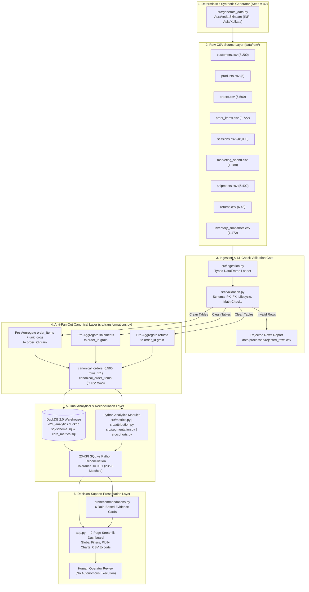

# System Architecture — D2C Growth & Profitability Control Tower

## 1. End-to-End Architecture Diagram (Mermaid)



---

## 2. Repository Structure

```text
D2C-Growth-Profitability-Control-Tower/
├── README.md                                    # Complete setup, methodology, and guide
├── LICENSE                                      # MIT License
├── requirements.txt                             # Python package dependencies
├── app.py                                       # 9-view Streamlit interactive application
├── .streamlit/
│   └── config.toml                              # Streamlit theme and server configuration
├── config/
│   ├── settings.example.toml                    # Template project configuration
│   └── settings.toml                            # Active local configuration (seed=42, INR)
├── data/
│   ├── README.md                                # Dataset provenance and simulation rules
│   ├── sample/                                  # Reference schema header CSVs
│   ├── raw/                                     # Generated raw synthetic CSVs (git-ignored)
│   └── processed/                               # DuckDB database & canonical CSVs (git-ignored)
├── src/
│   ├── __init__.py                              # Package metadata
│   ├── config.py                                # TOML settings loader & logging setup
│   ├── generate_data.py                         # Deterministic synthetic generator (seed=42)
│   ├── ingestion.py                             # CSV loader and type normalizer
│   ├── validation.py                            # 61-check data validation & rejection engine
│   ├── transformations.py                       # Anti-fan-out canonical builder & DuckDB loader
│   ├── metrics.py                               # Performance, funnel, economics, ops, inventory
│   ├── attribution.py                           # Spend, CAC, campaign ROAS, and blended MER
│   ├── segmentation.py                          # RFM scoring, repeat rate, and observed 6M LTV
│   ├── cohorts.py                               # Monthly acquisition cohort retention matrices
│   ├── recommendations.py                       # Rule-based recommendation engine
│   └── pipeline.py                              # End-to-end CLI pipeline orchestrator
├── sql/
│   ├── schema.sql                               # DuckDB DDL for all 9 source tables
│   └── core_metrics.sql                         # Parameterized analytical SQL queries
├── tests/
│   ├── test_validation.py                       # Schema, PK, FK, math, and rejection tests
│   ├── test_pipeline.py                         # Anti-fan-out & DuckDB integration tests
│   ├── test_metrics.py                          # Hand-calculated KPI & SQL reconciliation tests
│   ├── test_attribution.py                      # CAC, ROAS, MER, and zero-spend NA tests
│   ├── test_cohorts.py                          # RFM and monthly cohort retention tests
│   └── test_recommendations_and_dashboard.py    # Recommendation rules, filters, & Streamlit AppTest
├── screenshots/                                 # Live application screenshots (01..09)
└── docs/
    ├── ARCHITECTURE.md                          # System architecture & data flow
    ├── DATA_DICTIONARY.md                       # Complete schema and field definitions
    ├── DEPLOYMENT_GUIDE.md                      # Local, Streamlit Cloud & Docker deployment guide
    ├── FINAL_REPORT.md                          # Complete analytical report with computed results
    ├── INTERVIEW_PREPARATION.md                 # Project walkthroughs & technical/business Q&A
    ├── METRIC_DEFINITIONS.md                    # KPI formulas, denominators, and caveats
    ├── TECHNICAL_REVIEW.md                      # Architecture audit & 104k-order benchmark timings
    └── TEST_PLAN.md                             # Automated test suite documentation
```

---

## 3. Anti-Fan-Out Relational Design
Joining `orders` directly to multiple `order_items`, multiple `shipments`, and multiple `returns` causes Cartesian row multiplication within an order and inflates order-header metrics (`discount_amount`, `shipping_revenue`, `tax_amount`).

To guarantee **zero revenue duplication**:
1. `aggregate_order_items_to_order_grain()` aggregates `order_items` joined with `products.unit_cogs` to `1 row per order_id`.
2. `aggregate_shipments_to_order_grain()` aggregates `shipments` to `1 row per order_id`.
3. `aggregate_returns_to_order_grain()` aggregates `returns` to `1 row per order_id`.
4. `build_canonical_model()` merges these `1:1` summaries onto `orders` and asserts `len(canonical_orders) == len(orders)` (`6,500 == 6,500`) and `SUM(canonical_orders.net_merchandise_sales) == SUM(canonical_order_items.line_net_merchandise_sales)` (`₹3,949,725.97 == ₹3,949,725.97`).
